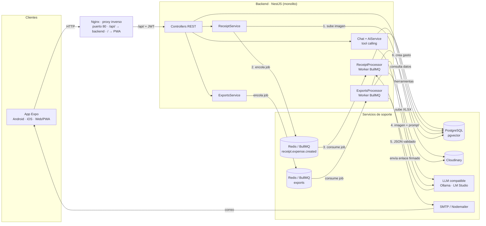
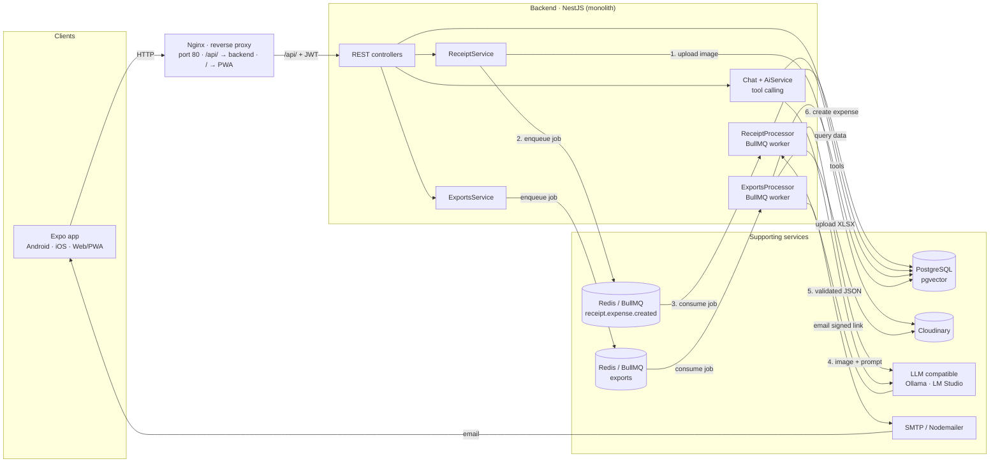

<div align="center">
  
  <h1>Finance Flow</h1>
  <p><strong>Finanzas personales con IA · Personal finance with AI</strong></p>
  <p>
    <a href="#es">🇪🇸 Español</a> · <a href="#en">🇬🇧 English</a>
  </p>
  <p>
    
    
    
    
    
  </p>
</div>

<a id="es"></a>

---

## 🇪🇸 Español

### ¿Qué es Finance Flow?

Finance Flow es una aplicación de finanzas personales que reúne gastos, ingresos, bolsillos, categorías, deudas y contactos en un mismo lugar, y añade dos capacidades de IA:

- **Asistente financiero por chat**: un modelo con herramientas (*tool calling*) que consulta y crea datos reales de la cuenta del usuario (resúmenes mensuales, balances, top categorías, creación de movimientos, etc.).
- **Escaneo inteligente de recibos**: compartes o fotografías un ticket, se sube a Cloudinary y un worker lo analiza con un modelo de visión para dar de alta el gasto automáticamente.

La misma base de código de la app móvil se publica para **Android, iOS y web (PWA)**, todas conectadas a un único backend NestJS.

### Características

- Autenticación local con JWT (access + refresh) y login con Google. Cookies con `credentials` en web y `expo-secure-store` en nativo.
- Gestión de gastos e ingresos con filtros por categoría/bolsillo, orden y paginación; detalle, edición y borrado.
- Bolsillos con balance calculado, categorías, deudas y contactos.
- Recibos con IA procesados en segundo plano (cola, reintentos y progreso del trabajo).
- Exportación de reportes XLSX en segundo plano (resumen y desglose), subidos a Cloudinary y enviados por correo con un enlace firmado.
- Chat con IA y herramientas financieras registradas en el backend.
- Tema claro/oscuro persistido, listas virtualizadas con FlashList y compartir imágenes desde otras apps (Android, iOS y PWA).
- Perfil con avatar y recuperación de contraseña por correo.

### Stack tecnológico

| Capa | Tecnologías |
| --- | --- |
| Backend (`apps/backend`) | NestJS 11, TypeScript, TypeORM 0.3, PostgreSQL 16 (pgvector), BullMQ 5, Passport + JWT, class-validator, Helmet, Throttler, Cloudinary, Nodemailer, Axios |
| App (`apps/mobile`) | Expo SDK 56, React Native 0.85, React 19, React Navigation 7, FlashList 2, Expo Camera / Image Picker / Secure Store / Updates / Share Intent, Reanimated |
| Paquetes compartidos (`packages`) | `api-client` (cliente Axios tipado) y `shared-types` (DTOs/tipos comunes), consumidos como workspaces de pnpm |
| Infraestructura | Docker Compose, Nginx, Vercel (PWA), EAS (builds y updates de Expo), LLM compatible con Chat Completions (Ollama, LM Studio u otro) |

### Estructura del repositorio

```text
finance-flow/
├── apps/
│   ├── backend/            # API REST + workers (NestJS)
│   │   ├── src/
│   │   │   ├── ai/          # Cliente LLM y orquestación de herramientas
│   │   │   ├── auth/        # JWT, refresh y Google OAuth
│   │   │   ├── chat/        # Historial y endpoint de chat
│   │   │   ├── financial-tools/ # Registro de herramientas para la IA
│   │   │   ├── transactions/    # Gastos, ingresos, recibos y processor BullMQ
│   │   │   ├── exports/         # Reportes XLSX: DTOs, cola `exports` y processor
│   │   │   ├── users/ categories/ wallets/ debts/ contacts/ mail/ cloudinary/
│   │   │   ├── common/ decorators/ models/ types/
│   │   │   ├── app.module.ts
│   │   │   └── main.ts
│   │   ├── assets/templates/    # Plantilla HTML del correo de reporte listo
│   │   ├── test/
│   │   ├── Dockerfile
│   │   └── .env.example
│   └── mobile/             # App Expo (Android, iOS y web)
│       ├── src/
│       │   ├── components/  # ui, layouts, auth, share
│       │   ├── context/     # Tema, snackbar, auth
│       │   ├── hooks/
│       │   ├── navigation/  # RootNavigator y MainTabNavigator
│       │   ├── screens/     # auth, home, transactions, scanner, chat, wallets,
│       │   │                # categories, debts, contacts, profile
│       │   ├── services/    # api, storage, sharedImage
│       │   ├── theme/       # Paletas claro/oscuro
│       │   └── utils/
│       ├── public/          # manifest.json y service worker del PWA
│       ├── plugins/         # Plugin nativo de Expo (cleartext traffic)
│       ├── app.json / eas.json
│       └── .env.example
├── packages/
│   ├── api-client/         # APIs tipadas por dominio
│   └── shared-types/       # Tipos compartidos backend ↔ mobile
├── docker-compose.yaml
├── nginx.conf              # Proxy /api → backend y SPA fallback
├── vercel.json             # Export web de Expo
├── pnpm-workspace.yaml
└── README.md
```

### Arquitectura

El backend es un **monolito modular**: una única aplicación NestJS expone la API REST y ejecuta los *workers* en el mismo proceso. La modularización es por dominio (módulos de Nest), no por servicio desplegado. Es una decisión deliberada: reduce la complejidad operativa y hace que el flujo de principio a fin sea fácil de seguir. La contrapartida es que API y workers escalan juntos.

La asincronía se concentra en la cola de tareas: la petición HTTP nunca espera a que el modelo de IA termine. Redis actúa como broker de la cola BullMQ; el processor consume los trabajos, reporta progreso y persiste el resultado en PostgreSQL.

La exportación sigue el mismo patrón: el endpoint solo encola el trabajo y devuelve un `jobId`. El worker construye el XLSX en memoria, lo sube a Cloudinary y envía el correo con el enlace. No se escribe ningún archivo en el servidor. Redis vuelve a aparecer aquí solo como broker de BullMQ.



En producción, Nginx es el único punto de entrada: sirve la PWA en `/` y redirige `/api/` al backend, todo bajo el mismo dominio. En desarrollo, el cliente apunta directamente a `http://localhost:3001`.

**Flujo de un recibo, paso a paso**

1. La app envía `POST /receipts` con `multipart/form-data` (campo `receipt`). El controlador sube el archivo a Cloudinary.
2. `ReceiptService` construye el *system prompt* con los nombres reales de bolsillos y categorías del usuario, recupera la imagen en base64 y encola el job `create-receipt` en `receipt.expense.created`: 3 intentos, *backoff* exponencial de 5 s, sin borrar los fallos.
3. La respuesta HTTP devuelve inmediatamente el aviso de que el procesamiento ha empezado. El worker actualiza el progreso (30 % → 65 % → 100 %).
4. El modelo extrae un JSON con comercio, monto, descripción, confianza, bolsillo y categoría candidatos. Se valida con `class-validator`; si no es un recibo o faltan campos, el job falla y se reintenta.
5. El worker crea el gasto asociado al recibo, al usuario y al bolsillo/categoría resueltos.

**Flujo de una exportación, paso a paso**

1. La app envía `POST /exports/short-reports` o `POST /exports/large-reports` con JWT y un cuerpo `{ "startDate": "…", "endDate": "…" }`. El `profileId` y el `userId` se toman del token, no del cuerpo.
2. `ExportsService` encola `create-short-report` o `create-large-report` en la cola `exports` (3 intentos, *backoff* exponencial de 5 s) y devuelve `{ "jobId": … }` de inmediato.
3. El worker distingue el tipo con `job.data.type` (unión discriminada) y genera el XLSX en memoria con ExcelJS: hojas `Gastos` e `Ingresos` en el corto; cuatro hojas agrupadas por categoría y bolsillo en el largo.
4. Los importes `numeric` de PostgreSQL se convierten a `number` antes de `addRow`/`addRows`; las filas de total escriben una fórmula `SUM` con su `result` ya calculado, porque ExcelJS no evalúa fórmulas.
5. El buffer se sube a Cloudinary en `finance-flow/reports` con `resource_type: 'raw'` y `type: 'authenticated'`. No se guarda nada en disco.
6. Se genera una URL de descarga firmada con `private_download_url` (válida 24 h, `attachment: true`) y se envía por correo usando `assets/templates/report-ready.html`.
7. Los jobs completados se descartan (`removeOnComplete: true`); los fallidos se conservan para inspección.

**Notas de diseño**

- Los DTOs se validan globalmente (`whitelist` y `forbidNonWhitelisted`); las respuestas pasan por `ClassSerializerInterceptor`.
- CORS es una lista blanca de orígenes, `helmet` añade cabeceras de seguridad y el guard global limita peticiones (60 por minuto).
- El cliente de IA admite *tool calling* con un máximo de 8 iteraciones por respuesta; las herramientas consultan la base de datos con el `profileId` del usuario autenticado.
- TypeORM usa `synchronize: true` para desarrollo. Desactívalo y usa migraciones antes de cualquier despliegue con datos reales.
- El enlace del correo es una *capability URL*: quien la tenga puede descargar hasta que caduca. La autorización se hace en el endpoint, antes de encolar; el `type: 'authenticated'` de Cloudinary solo exige firma en la entrega.
- El `Dockerfile` copia `apps/backend/assets` al contenedor porque la plantilla del correo se lee del sistema de archivos en producción.

### Backend — `apps/backend/`

| Área | Módulos / responsabilidad |
| --- | --- |
| Identidad | `auth`, `users`: registro/login, access y refresh token, Google OAuth, perfil y avatar |
| Finanzas | `transactions` (gastos, ingresos y recibos), `wallets`, `categories`, `debts`, `contacts` |
| Reportes | `exports` (XLSX en segundo plano, subida a Cloudinary y aviso por correo) |
| Inteligencia artificial | `ai` (cliente LLM y extracción de recibos), `financial-tools` (registro de herramientas), `chat` |
| Integraciones | `cloudinary` (imágenes y reportes `raw`), `mail` (recuperación de contraseña y reportes listos) |
| Transversales | `common`, `decorators`, `models`, `types`; configuración global en `app.module.ts` y `main.ts` |

Comandos útiles (se ejecutan desde la raíz con el filtro de pnpm o dentro de `apps/backend/`):

| Acción | Comando |
| --- | --- |
| Desarrollo (watch) | `pnpm backend:dev` |
| Arrancar | `pnpm --filter @finance-flow/backend start` |
| Build (incluye tests) | `pnpm --filter @finance-flow/backend build` |
| Lint (con `--fix`) | `pnpm --filter @finance-flow/backend lint` |
| Formatear | `pnpm --filter @finance-flow/backend format` |
| Producción | `pnpm --filter @finance-flow/backend start:prod` |

El API escucha en el puerto `3001` por defecto (variable `PORT`).

### Endpoints de la API

Base: en desarrollo `http://localhost:3001`; en producción, el mismo dominio bajo el prefijo `/api/` (Nginx). Las rutas de registro y autenticación/recuperación son públicas; el resto requiere JWT (header `Authorization: Bearer <token>` o cookie httpOnly en web). Los parámetros `:id` son numéricos.

| Área | Método | Ruta | Descripción |
| --- | --- | --- | --- |
| Auth | `POST` | `/auth/login` | Login con email y contraseña; emite access + refresh y fija cookies httpOnly (máx. 5 intentos/min). |
| Auth | `POST` | `/auth/refresh` | Renueva el par de tokens a partir del refresh token (body o cookie). |
| Auth | `POST` | `/auth/logout` | Revoca el refresh token y limpia las cookies. |
| Auth | `POST` | `/auth/forgot-password` | Envía por correo el enlace de recuperación de contraseña. |
| Auth | `GET` | `/auth/recovery-password?token=…` | Redirige al reset de la web o al deep link `finance-flow://reset-password`. |
| Auth | `POST` | `/auth/reset-password?token=…` | Guarda la contraseña nueva usando el token de recuperación. |
| Auth | `GET` | `/auth` | Inicia el flujo de login con Google (OAuth). |
| Auth | `GET` | `/auth/google-redirect` | Callback de Google; redirige con los tokens a la app nativa o a `/home`. |
| Usuarios | `POST` | `/users` | Registro de usuario. |
| Usuarios | `GET` | `/users` | Lista paginada de usuarios (solo rol admin). |
| Usuarios | `GET` | `/users/me` | Datos del usuario autenticado. |
| Usuarios | `GET` | `/users/profiles?name=…` | Busca perfiles por nombre para añadir contactos. |
| Usuarios | `GET` | `/users/me/profile` | Perfil del usuario autenticado. |
| Usuarios | `PATCH` | `/users` | Actualiza los datos del usuario. |
| Usuarios | `POST` | `/users/upload-avatar` | Sube el avatar a Cloudinary (multipart `avatar`). |
| Usuarios | `PATCH` | `/users/change-password` | Cambia la contraseña verificando la actual. |
| Usuarios | `DELETE` | `/users` | Elimina la cuenta confirmando con la contraseña. |
| Categorías | `POST` | `/categories` | Crea una categoría del perfil. |
| Categorías | `GET` | `/categories` | Lista categorías con paginación y filtro por tipo. |
| Categorías | `GET` | `/categories/breakdown` | Desglose del gasto por categoría en un periodo. |
| Categorías | `GET` | `/categories/:id` | Detalle de una categoría. |
| Categorías | `PATCH` | `/categories/:id` | Edita una categoría. |
| Categorías | `DELETE` | `/categories/:id` | Elimina una categoría. |
| Bolsillos | `POST` | `/wallets` | Crea un bolsillo. |
| Bolsillos | `GET` | `/wallets` | Lista bolsillos paginados. |
| Bolsillos | `GET` | `/wallets/balance` | Balance global del perfil (ingresos, gastos y total). |
| Bolsillos | `GET` | `/wallets/balance/:id` | Balance de un bolsillo concreto. |
| Bolsillos | `GET` | `/wallets/:id` | Detalle del bolsillo. |
| Bolsillos | `PATCH` | `/wallets/:id` | Edita un bolsillo. |
| Bolsillos | `DELETE` | `/wallets/:id` | Elimina un bolsillo. |
| Gastos | `GET` | `/expenses` | Lista gastos con filtros (categoría, bolsillo, orden, paginación). |
| Gastos | `GET` | `/expenses/:id` | Detalle de un gasto. |
| Gastos | `POST` | `/expenses` | Crea un gasto. |
| Gastos | `PATCH` | `/expenses/:id` | Edita un gasto. |
| Gastos | `DELETE` | `/expenses/:id` | Elimina un gasto. |
| Ingresos | `GET` | `/earnings` | Lista ingresos con los mismos filtros que los gastos. |
| Ingresos | `GET` | `/earnings/:id` | Detalle de un ingreso. |
| Ingresos | `POST` | `/earnings` | Crea un ingreso. |
| Ingresos | `PATCH` | `/earnings/:id` | Edita un ingreso. |
| Ingresos | `DELETE` | `/earnings/:id` | Elimina un ingreso. |
| Recibos | `GET` | `/receipts` | Lista recibos paginados del perfil. |
| Recibos | `GET` | `/receipts/:id` | Detalle de un recibo. |
| Recibos | `POST` | `/receipts` | Sube una imagen (multipart `receipt`) a Cloudinary y encola su análisis con IA. |
| Recibos | `DELETE` | `/receipts/:id` | Elimina un recibo. |
| Transacciones | `GET` | `/transactions` | Línea de tiempo unificada de gastos e ingresos con filtros. |
| Transacciones | `GET` | `/transactions/summary` | Resumen agregado del periodo seleccionado. |
| Reportes | `POST` | `/exports/short-reports` | Encola un XLSX con gastos e ingresos del periodo; devuelve `{ jobId }`. |
| Reportes | `POST` | `/exports/large-reports` | Encola un XLSX con desgloses por categoría y bolsillo; devuelve `{ jobId }`. |
| Chat IA | `POST` | `/chat` | Envía un mensaje al asistente con herramientas financieras (máx. 10 cada 10 min). |
| Chat IA | `GET` | `/chat` | Historial de mensajes (admite `limit`). |
| Chat IA | `DELETE` | `/chat/:id` | Elimina un mensaje del historial. |
| Contactos | `POST` | `/contacts` | Envía una solicitud de contacto por `addresseeId`. |
| Contactos | `GET` | `/contacts` | Lista contactos aceptados. |
| Contactos | `GET` | `/contacts/pending/sent` | Solicitudes enviadas pendientes. |
| Contactos | `GET` | `/contacts/pending/received` | Solicitudes recibidas pendientes. |
| Contactos | `GET` | `/contacts/pending/received/count` | Número de solicitudes recibidas pendientes. |
| Contactos | `GET` | `/contacts/:id` | Detalle de un contacto. |
| Contactos | `PATCH` | `/contacts/:id/accept` | Acepta una solicitud de contacto. |
| Contactos | `PATCH` | `/contacts/:id/reject` | Rechaza una solicitud de contacto. |
| Contactos | `DELETE` | `/contacts/:id` | Elimina un contacto. |
| Deudas | `POST` | `/debts` | Crea una deuda. |
| Deudas | `GET` | `/debts` | Lista deudas con filtros. |
| Deudas | `GET` | `/debts/summary` | Resumen de deudas pendientes y pagadas. |
| Deudas | `GET` | `/debts/:id` | Detalle de una deuda. |
| Deudas | `PATCH` | `/debts/:id` | Edita una deuda. |
| Deudas | `PATCH` | `/debts/:id/pay` | Marca una deuda como pagada; admite comprobante opcional (multipart `receipt`). |
| Deudas | `DELETE` | `/debts/:id` | Elimina una deuda. |

Los límites globales son 60 peticiones/minuto; login y recuperación tienen un límite específico de 5/minuto y el chat de 10 cada 10 minutos. Ambos endpoints de exportación requieren JWT y reciben `{ "startDate": "…", "endDate": "…" }`; responden con `{ "jobId": … }` y el XLSX llega por correo cuando el job termina.

### Mobile app — `apps/mobile/`

Proyecto Expo (SDK 56) con destino nativo y web desde una sola carpeta `src/`:

- **Navegación**: `RootNavigator` controla auth y la entrega de imágenes compartidas; `MainTabNavigator` agrupa Home, Movimientos, Escáner, Chat y Perfil.
- **Pantallas**: flujos de login/registro/recuperación, dashboard, listas y filtros, escáner de recibos, chat con IA, bolsillos, categorías, deudas, contactos y perfil.
- **Recibos**: cámara, galería o *share intent*. En Android se usa `expo-share-intent` (intent filter `image/*`) y en PWA el `share_target` del manifest; la imagen pendiente se conserva durante el login y se abre el escáner al entrar.
- **Tema y UI**: paletas claro/oscuro con `ThemeContext` persistido en SecureStore, `GlassCard`, componentes memoizados y FlashList para listas largas.
- **Acceso a la API**: `src/services/api.ts` configura el cliente con token en SecureStore (nativo) o cookies (web) e inyecta los clientes de `packages/api-client`.

| Acción | Comando |
| --- | --- |
| Metro / dev server | `pnpm mobile:start` |
| Android (nativo) | `pnpm --filter @finance-flow/mobile android` |
| iOS (nativo) | `pnpm --filter @finance-flow/mobile ios` |
| Web / PWA | `pnpm --filter @finance-flow/mobile web` |

> Tras cambiar los plugins de `app.json` (por ejemplo el intent filter), regenera los proyectos nativos con `npx expo prebuild --clean` y vuelve a compilar. La carpeta `android/` existente impide que Expo vuelva a aplicar los cambios automáticamente.

### Puesta en marcha

**Requisitos**

- Node.js 22 o superior y pnpm 10 (recomendado vía `corepack enable`). El workspace usa `node-linker=hoisted` en `.npmrc`.
- Docker con Docker Compose (para PostgreSQL, Redis, pgAdmin y el proxy Nginx).
- Un endpoint LLM compatible con Chat Completions y credenciales de Cloudinary. Google OAuth y SMTP son necesarios solo para esos flujos.
- Para la app nativa: Expo Go o Android Studio / Xcode; para probar en un dispositivo físico, que esté en la misma red que el backend.

**1. Instalar dependencias y configurar entorno**

```bash
pnpm install
cp apps/backend/.env.example apps/backend/.env
cp apps/mobile/.env.example apps/mobile/.env
# Edita ambos .env con tus valores
```

**2. Levantar infraestructura y backend**

```bash
docker compose up -d db redis pgadmin      # solo infraestructura
pnpm backend:dev                           # http://localhost:3001

# Pila completa (backend + PWA + Nginx en el puerto 80):
docker compose up --build
```

En Docker Compose, el backend recibe `HOST_DB=db` y `HOST_QUEUE=redis`; pgAdmin está en `http://localhost:8080`.

**3. Levantar la app**

```bash
# Dispositivo físico: usa la IP de la LAN, no localhost
# EXPO_PUBLIC_API_URL=http://192.168.x.x:3001
pnpm mobile:start

# Web/PWA en http://localhost:8081
pnpm --filter @finance-flow/mobile web
```

### Variables de entorno

Backend (`apps/backend/.env`, plantilla en `.env.example`):

| Variable | Uso |
| --- | --- |
| `PORT` | Puerto HTTP del API (por defecto 3001) |
| `HOST_DB`, `PORT_DB`, `USER_DB`, `PASSWORD_DB`, `NAME_DB` | Conexión a PostgreSQL |
| `SECRET_ACCESS_KEY`, `SECRET_REFRESH_KEY`, `EXPIRES_ACCESS_KEY`, `EXPIRES_REFRESH_KEY` | Firma y caducidad de tokens JWT |
| `CLOUDINARY_CLOUD_NAME`, `CLOUDINARY_API_KEY`, `CLOUDINARY_API_SECRET` | Subida de imágenes y reportes `raw`, y firma de URLs de descarga |
| `AI_URL`, `MODEL_AI` | Endpoint y modelo del LLM |
| `HOST_QUEUE`, `PORT_QUEUE` | Conexión al broker de BullMQ |
| `EMAIL_HOST`, `EMAIL_PORT`, `EMAIL_USER`, `EMAIL_PASS` | Envío de correos |
| `RECOVERY_PASSWORD_URL`, `WEB_URL` | Enlaces de recuperación y origen permitido en CORS |
| `GOOGLE_CLIENT_ID`, `GOOGLE_CLIENT_SECRET`, `GOOGLE_CALLBACK_URL` | Login con Google |

Mobile (`apps/mobile/.env`):

| Variable | Uso |
| --- | --- |
| `EXPO_PUBLIC_API_URL` | URL base del API. En web, el build de Docker usa `/api` y Nginx redirige al backend |

### Testing y lint

```bash
pnpm --filter @finance-flow/backend test        # unitarios (Jest)
pnpm --filter @finance-flow/backend test:watch
pnpm --filter @finance-flow/backend test:cov
pnpm --filter @finance-flow/backend test:e2e    # requiere configurar el entorno de test
pnpm --filter @finance-flow/backend lint
pnpm --filter @finance-flow/backend format
```

Estado actual: la cobertura es incipiente (hay un spec unitario de categories y el directorio `test/` aún está vacío), así que las pruebas e2e son un área de mejora.

### Despliegue

#### Nginx: un solo dominio para web y API

En producción, Nginx es el único punto de entrada expuesto (puerto 80). Según `nginx.conf`:

- `/api/` → `http://backend:3001/`, reenviando `Host`, `X-Real-IP`, `X-Forwarded-For` y `X-Forwarded-Proto`.
- `/` → el export estático de la PWA (`/usr/share/nginx/html`), con *fallback* a `index.html` para rutas SPA.
- `client_max_body_size 10M` para admitir subidas de recibos y avatares.

Frontend y API comparten por tanto **el mismo dominio y puerto**: no hay CORS entre dominios y el build web fija `EXPO_PUBLIC_API_URL=/api` (ver `apps/mobile/Dockerfile`).

#### Docker Compose: la app completa con un comando

```bash
docker compose up --build
```

Este único comando levanta PostgreSQL/pgvector, Redis, pgAdmin, el backend y la PWA, **con el proxy inverso de Nginx ya aplicado**. Abre `http://localhost` para la web y `http://localhost/api/...` para la API (pgAdmin en `http://localhost:8080`). No hace falta arrancar Metro ni el backend por separado en este modo.

#### Otros destinos

- **Web en Vercel**: `vercel.json` ejecuta `npx expo export --platform web` desde `apps/mobile`, publica `apps/mobile/dist` y reescribe las rutas a `index.html` (SPA). Define `EXPO_PUBLIC_API_URL` en el entorno de build.
- **Nativo con EAS**: `eas.json` define los perfiles `development` (development client, distribución interna), `preview` y `production` (APK en Android), con Node 22.14 y pnpm 10.27. Las actualizaciones OTA usan la URL de `app.json`.

Antes de producción: desactiva `synchronize`, revisa las credenciales de `apps/backend/.env` y comprueba la lista blanca de CORS con tu dominio real.

### Roadmap / estado

Proyecto en desarrollo activo, construido de forma esporádica durante varios meses. Próximos pasos previstos:

- Documentación interactiva de la API con Swagger/OpenAPI.
- Sustituir `synchronize` por migraciones versionadas de TypeORM.
- Ampliar la cobertura de tests (especialmente e2e del flujo de recibos).
- Añadir CI para build, lint y tests.
- Consultar el estado de los jobs de exportación (y conservar el resultado) si el cliente lo necesita.

---

<a id="en"></a>

## 🇬🇧 English

### What is Finance Flow?

Finance Flow is a personal finance app that brings expenses, earnings, wallets, categories, debts and contacts together in one place, with two AI capabilities:

- **AI financial assistant**: a chat model with tool calling that reads and writes real user data (monthly summaries, balances, top categories, creating transactions, etc.).
- **Smart receipt scanning**: share or photograph a ticket, upload it to Cloudinary and let a worker analyse it with a vision model to create the expense automatically.

The same mobile codebase targets **Android, iOS and web (PWA)**, all talking to a single NestJS backend.

### Features

- Local auth with JWT (access + refresh) plus Google sign-in. Cookies with credentials on web, `expo-secure-store` on native.
- Expenses and earnings with category/wallet filters, sorting and pagination; detail, edit and delete.
- Wallets with computed balances, categories, debts and contacts.
- AI-powered receipts processed in the background (queue, retries and job progress).
- XLSX report exports processed in the background (summary and breakdown), uploaded to Cloudinary and emailed with a signed link.
- AI chat backed by financial tools registered in the backend.
- Dark/light theme with persistence, virtualised lists with FlashList, and image sharing from other apps (Android, iOS and PWA).
- Profile with avatar and password recovery by email.

### Tech stack

| Layer | Technologies |
| --- | --- |
| Backend (`apps/backend`) | NestJS 11, TypeScript, TypeORM 0.3, PostgreSQL 16 (pgvector), BullMQ 5, Passport + JWT, class-validator, Helmet, Throttler, Cloudinary, Nodemailer, Axios |
| App (`apps/mobile`) | Expo SDK 56, React Native 0.85, React 19, React Navigation 7, FlashList 2, Expo Camera / Image Picker / Secure Store / Updates / Share Intent, Reanimated |
| Shared packages (`packages`) | `api-client` (typed Axios client) and `shared-types` (shared DTOs/types), consumed as pnpm workspaces |
| Infrastructure | Docker Compose, Nginx, Vercel (PWA), EAS (Expo builds and updates), OpenAI-compatible LLM (Ollama, LM Studio or another) |

### Repository structure

```text
finance-flow/
├── apps/
│   ├── backend/            # REST API + workers (NestJS)
│   │   ├── src/
│   │   │   ├── ai/          # LLM client and tool orchestration
│   │   │   ├── auth/        # JWT, refresh and Google OAuth
│   │   │   ├── chat/        # History and chat endpoint
│   │   │   ├── financial-tools/ # Tool registry for the AI
│   │   │   ├── transactions/    # Expenses, earnings, receipts and BullMQ processor
│   │   │   ├── exports/         # XLSX reports: DTOs, `exports` queue and processor
│   │   │   ├── users/ categories/ wallets/ debts/ contacts/ mail/ cloudinary/
│   │   │   ├── common/ decorators/ models/ types/
│   │   │   ├── app.module.ts
│   │   │   └── main.ts
│   │   ├── assets/templates/    # HTML template for the report-ready email
│   │   ├── test/
│   │   ├── Dockerfile
│   │   └── .env.example
│   └── mobile/             # Expo app (Android, iOS and web)
│       ├── src/
│       │   ├── components/  # ui, layouts, auth, share
│       │   ├── context/     # Theme, snackbar, auth
│       │   ├── hooks/
│       │   ├── navigation/  # RootNavigator and MainTabNavigator
│       │   ├── screens/     # auth, home, transactions, scanner, chat, wallets,
│       │   │                # categories, debts, contacts, profile
│       │   ├── services/    # api, storage, sharedImage
│       │   ├── theme/       # Light/dark palettes
│       │   └── utils/
│       ├── public/          # PWA manifest and service worker
│       ├── plugins/         # Expo native plugin (cleartext traffic)
│       ├── app.json / eas.json
│       └── .env.example
├── packages/
│   ├── api-client/         # Typed APIs by domain
│   └── shared-types/       # Types shared backend ↔ mobile
├── docker-compose.yaml
├── nginx.conf              # /api proxy → backend and SPA fallback
├── vercel.json             # Expo web export
├── pnpm-workspace.yaml
└── README.md
```

### Architecture

The backend is a **modular monolith**: a single NestJS application exposes the REST API and runs the workers in the same process. Modules are organised by domain, not deployed as separate services. This keeps operations simple and the end-to-end flow easy to follow; the trade-off is that the API and workers scale together.

Asynchrony is concentrated in the task queue: the HTTP request never waits for the model to finish. Redis acts as the BullMQ broker, while the processor consumes jobs, reports progress and persists the result in PostgreSQL.

Exports follow the same pattern: the endpoint only enqueues the job and returns a `jobId`. The worker builds the XLSX in memory, uploads it to Cloudinary and sends the email with the link. No file is written to the server. Redis appears here only as the BullMQ broker.



In production, Nginx is the single entry point: it serves the PWA at `/` and forwards `/api/` to the backend, all under the same domain. In development, the client points directly to `http://localhost:3001`.

**Receipt flow, step by step**

1. The app sends `POST /receipts` as `multipart/form-data` (field `receipt`). The controller uploads the file to Cloudinary.
2. `ReceiptService` builds the system prompt with the user's real wallet and category names, fetches the image as base64 and enqueues the `create-receipt` job on `receipt.expense.created`: 3 attempts, 5 s exponential backoff, failed jobs retained.
3. The HTTP response returns immediately with an acknowledgement that processing has started. The worker reports progress (30 % → 65 % → 100 %).
4. The model extracts JSON with merchant, amount, description, confidence and candidate wallet/category. It is validated with `class-validator`; a non-receipt or missing fields fails the job and triggers a retry.
5. The worker creates the expense linked to the receipt, the user and the resolved wallet/category.

**Export flow, step by step**

1. The app sends `POST /exports/short-reports` or `POST /exports/large-reports` with JWT and a body `{ "startDate": "…", "endDate": "…" }`. `profileId` and `userId` come from the token, not the body.
2. `ExportsService` enqueues `create-short-report` or `create-large-report` on the `exports` queue (3 attempts, 5 s exponential backoff) and immediately returns `{ "jobId": … }`.
3. The worker discriminates the type with `job.data.type` and builds the XLSX in memory with ExcelJS: `Gastos`/`Ingresos` sheets for the short report; four sheets grouped by category and wallet for the large one.
4. PostgreSQL `numeric` amounts are converted to `number` before `addRow`/`addRows`; total rows write a `SUM` formula with an already computed `result`, since ExcelJS does not evaluate formulas.
5. The buffer is uploaded to Cloudinary under `finance-flow/reports` with `resource_type: 'raw'` and `type: 'authenticated'`. Nothing is stored on disk.
6. A signed download URL is generated with `private_download_url` (valid for 24 h, `attachment: true`) and emailed using `assets/templates/report-ready.html`.
7. Completed jobs are discarded (`removeOnComplete: true`); failed jobs are kept for inspection.

**Design notes**

- DTOs are validated globally (`whitelist` and `forbidNonWhitelisted`); responses go through `ClassSerializerInterceptor`.
- CORS uses an allowlist, `helmet` sets security headers and a global guard rate-limits requests (60 per minute).
- The LLM client supports tool calling with a maximum of 8 iterations per response; tools query the database using the authenticated user's `profileId`.
- TypeORM uses `synchronize: true` for development. Disable it and use migrations before deploying with real data.
- The emailed link is a *capability URL*: anyone holding it can download until it expires. Authorisation happens at the endpoint, before enqueueing; Cloudinary's `type: 'authenticated'` only requires a signature at delivery time.
- The backend `Dockerfile` copies `apps/backend/assets` into the container because the email template is read from the filesystem in production.

### Backend — `apps/backend/`

| Area | Modules / responsibility |
| --- | --- |
| Identity | `auth`, `users`: sign-up/login, access and refresh tokens, Google OAuth, profile and avatar |
| Finance | `transactions` (expenses, earnings and receipts), `wallets`, `categories`, `debts`, `contacts` |
| Reports | `exports` (background XLSX generation, Cloudinary upload and email notification) |
| Artificial intelligence | `ai` (LLM client and receipt extraction), `financial-tools` (tool registry), `chat` |
| Integrations | `cloudinary` (images and raw reports), `mail` (password recovery and ready reports) |
| Cross-cutting | `common`, `decorators`, `models`, `types`; global setup in `app.module.ts` and `main.ts` |

Useful commands (run from the root with the pnpm filter or inside `apps/backend/`):

| Action | Command |
| --- | --- |
| Development (watch) | `pnpm backend:dev` |
| Start | `pnpm --filter @finance-flow/backend start` |
| Build (runs tests) | `pnpm --filter @finance-flow/backend build` |
| Lint (with `--fix`) | `pnpm --filter @finance-flow/backend lint` |
| Format | `pnpm --filter @finance-flow/backend format` |
| Production | `pnpm --filter @finance-flow/backend start:prod` |

The API listens on port `3001` by default (`PORT` variable).

### API endpoints

Base URL: `http://localhost:3001` in development; in production the same domain under the `/api/` prefix (Nginx). Sign-up and auth/recovery routes are public; all others require JWT (`Authorization: Bearer <token>` header or httpOnly cookie on web). The `:id` parameters are numeric.

| Area | Method | Route | Description |
| --- | --- | --- | --- |
| Auth | `POST` | `/auth/login` | Email/password sign-in; issues access + refresh tokens and sets httpOnly cookies (max. 5 attempts/min). |
| Auth | `POST` | `/auth/refresh` | Renews the token pair from the refresh token (body or cookie). |
| Auth | `POST` | `/auth/logout` | Revokes the refresh token and clears cookies. |
| Auth | `POST` | `/auth/forgot-password` | Emails the password recovery link. |
| Auth | `GET` | `/auth/recovery-password?token=…` | Redirects to web reset or the `finance-flow://reset-password` deep link. |
| Auth | `POST` | `/auth/reset-password?token=…` | Saves the new password using the recovery token. |
| Auth | `GET` | `/auth` | Starts Google OAuth sign-in. |
| Auth | `GET` | `/auth/google-redirect` | Google callback; redirects with tokens to the native app or `/home`. |
| Users | `POST` | `/users` | Registers a user. |
| Users | `GET` | `/users` | Paginated user list (admin role only). |
| Users | `GET` | `/users/me` | Authenticated user's data. |
| Users | `GET` | `/users/profiles?name=…` | Searches profiles by name to add contacts. |
| Users | `GET` | `/users/me/profile` | Authenticated user's profile. |
| Users | `PATCH` | `/users` | Updates user data. |
| Users | `POST` | `/users/upload-avatar` | Uploads the avatar to Cloudinary (multipart `avatar`). |
| Users | `PATCH` | `/users/change-password` | Changes the password after verifying the current one. |
| Users | `DELETE` | `/users` | Deletes the account after password confirmation. |
| Categories | `POST` | `/categories` | Creates a category for the profile. |
| Categories | `GET` | `/categories` | Lists categories with pagination and type filter. |
| Categories | `GET` | `/categories/breakdown` | Spending breakdown by category for a period. |
| Categories | `GET` | `/categories/:id` | Category detail. |
| Categories | `PATCH` | `/categories/:id` | Updates a category. |
| Categories | `DELETE` | `/categories/:id` | Deletes a category. |
| Wallets | `POST` | `/wallets` | Creates a wallet. |
| Wallets | `GET` | `/wallets` | Lists wallets with pagination. |
| Wallets | `GET` | `/wallets/balance` | Profile-wide balance (earnings, expenses and total). |
| Wallets | `GET` | `/wallets/balance/:id` | Balance of a specific wallet. |
| Wallets | `GET` | `/wallets/:id` | Wallet detail. |
| Wallets | `PATCH` | `/wallets/:id` | Updates a wallet. |
| Wallets | `DELETE` | `/wallets/:id` | Deletes a wallet. |
| Expenses | `GET` | `/expenses` | Lists expenses with filters (category, wallet, sort, pagination). |
| Expenses | `GET` | `/expenses/:id` | Expense detail. |
| Expenses | `POST` | `/expenses` | Creates an expense. |
| Expenses | `PATCH` | `/expenses/:id` | Updates an expense. |
| Expenses | `DELETE` | `/expenses/:id` | Deletes an expense. |
| Earnings | `GET` | `/earnings` | Lists earnings with the same filters as expenses. |
| Earnings | `GET` | `/earnings/:id` | Earning detail. |
| Earnings | `POST` | `/earnings` | Creates an earning. |
| Earnings | `PATCH` | `/earnings/:id` | Updates an earning. |
| Earnings | `DELETE` | `/earnings/:id` | Deletes an earning. |
| Receipts | `GET` | `/receipts` | Lists the profile's paginated receipts. |
| Receipts | `GET` | `/receipts/:id` | Receipt detail. |
| Receipts | `POST` | `/receipts` | Uploads an image (multipart `receipt`) to Cloudinary and enqueues AI analysis. |
| Receipts | `DELETE` | `/receipts/:id` | Deletes a receipt. |
| Transactions | `GET` | `/transactions` | Unified timeline of expenses and earnings with filters. |
| Transactions | `GET` | `/transactions/summary` | Aggregated summary for the selected period. |
| Reports | `POST` | `/exports/short-reports` | Enqueues an XLSX with expenses and earnings for the period; returns `{ jobId }`. |
| Reports | `POST` | `/exports/large-reports` | Enqueues an XLSX with category and wallet breakdowns; returns `{ jobId }`. |
| AI chat | `POST` | `/chat` | Sends a message to the assistant with financial tools (max. 10 per 10 min). |
| AI chat | `GET` | `/chat` | Message history (accepts `limit`). |
| AI chat | `DELETE` | `/chat/:id` | Deletes a message from the history. |
| Contacts | `POST` | `/contacts` | Sends a contact request by `addresseeId`. |
| Contacts | `GET` | `/contacts` | Lists accepted contacts. |
| Contacts | `GET` | `/contacts/pending/sent` | Pending sent requests. |
| Contacts | `GET` | `/contacts/pending/received` | Pending received requests. |
| Contacts | `GET` | `/contacts/pending/received/count` | Number of pending received requests. |
| Contacts | `GET` | `/contacts/:id` | Contact detail. |
| Contacts | `PATCH` | `/contacts/:id/accept` | Accepts a contact request. |
| Contacts | `PATCH` | `/contacts/:id/reject` | Rejects a contact request. |
| Contacts | `DELETE` | `/contacts/:id` | Deletes a contact. |
| Debts | `POST` | `/debts` | Creates a debt. |
| Debts | `GET` | `/debts` | Lists debts with filters. |
| Debts | `GET` | `/debts/summary` | Summary of pending and paid debts. |
| Debts | `GET` | `/debts/:id` | Debt detail. |
| Debts | `PATCH` | `/debts/:id` | Updates a debt. |
| Debts | `PATCH` | `/debts/:id/pay` | Marks a debt as paid; accepts an optional receipt (multipart `receipt`). |
| Debts | `DELETE` | `/debts/:id` | Deletes a debt. |

Global limits are 60 requests/minute; login and recovery are capped at 5/minute and chat at 10 per 10 minutes. Both export endpoints require JWT and accept `{ "startDate": "…", "endDate": "…" }`; they respond with `{ "jobId": … }` and the XLSX is emailed when the job finishes.

### Mobile app — `apps/mobile/`

An Expo project (SDK 56) targeting native and web from a single `src/` folder:

- **Navigation**: `RootNavigator` handles auth and delivery of shared images; `MainTabNavigator` groups Home, Transactions, Scanner, Chat and Profile.
- **Screens**: login/register/password recovery, dashboard, lists and filters, receipt scanner, AI chat, wallets, categories, debts, contacts and profile.
- **Receipts**: camera, gallery or share intent. Android uses `expo-share-intent` (an `image/*` intent filter) and the PWA uses the manifest's `share_target`; the pending image survives login and opens the scanner on entry.
- **Theme and UI**: light/dark palettes via `ThemeContext` persisted with SecureStore, `GlassCard`, memoised components and FlashList for long lists.
- **API access**: `src/services/api.ts` configures the client with a token in SecureStore (native) or cookies (web) and wires up the clients from `packages/api-client`.

| Action | Command |
| --- | --- |
| Metro / dev server | `pnpm mobile:start` |
| Android (native) | `pnpm --filter @finance-flow/mobile android` |
| iOS (native) | `pnpm --filter @finance-flow/mobile ios` |
| Web / PWA | `pnpm --filter @finance-flow/mobile web` |

> After changing plugins in `app.json` (for example the intent filter), regenerate the native projects with `npx expo prebuild --clean` and rebuild. An existing `android/` folder prevents Expo from reapplying the changes automatically.

### Getting started

**Requirements**

- Node.js 22+ and pnpm 10 (recommended via `corepack enable`). The workspace sets `node-linker=hoisted` in `.npmrc`.
- Docker with Docker Compose (PostgreSQL, Redis, pgAdmin and the Nginx proxy).
- An OpenAI-compatible LLM endpoint and Cloudinary credentials. Google OAuth and SMTP are only needed for those flows.
- For native: Expo Go or Android Studio / Xcode. For a physical device, keep it on the same network as the backend.

**1. Install dependencies and configure the environment**

```bash
pnpm install
cp apps/backend/.env.example apps/backend/.env
cp apps/mobile/.env.example apps/mobile/.env
# Fill in both .env files with your values
```

**2. Start the infrastructure and backend**

```bash
docker compose up -d db redis pgadmin      # infrastructure only
pnpm backend:dev                           # http://localhost:3001

# Full stack (backend + PWA + Nginx on port 80):
docker compose up --build
```

Compose passes `HOST_DB=db` and `HOST_QUEUE=redis` to the backend; pgAdmin is available at `http://localhost:8080`.

**3. Start the app**

```bash
# Physical device: use your LAN IP, not localhost
# EXPO_PUBLIC_API_URL=http://192.168.x.x:3001
pnpm mobile:start

# Web/PWA at http://localhost:8081
pnpm --filter @finance-flow/mobile web
```

### Environment variables

Backend (`apps/backend/.env`, template in `.env.example`):

| Variable | Purpose |
| --- | --- |
| `PORT` | API HTTP port (3001 by default) |
| `HOST_DB`, `PORT_DB`, `USER_DB`, `PASSWORD_DB`, `NAME_DB` | PostgreSQL connection |
| `SECRET_ACCESS_KEY`, `SECRET_REFRESH_KEY`, `EXPIRES_ACCESS_KEY`, `EXPIRES_REFRESH_KEY` | JWT signing and expiry |
| `CLOUDINARY_CLOUD_NAME`, `CLOUDINARY_API_KEY`, `CLOUDINARY_API_SECRET` | Image and raw report uploads, and signed download URLs |
| `AI_URL`, `MODEL_AI` | LLM endpoint and model |
| `HOST_QUEUE`, `PORT_QUEUE` | BullMQ broker connection |
| `EMAIL_HOST`, `EMAIL_PORT`, `EMAIL_USER`, `EMAIL_PASS` | Email delivery |
| `RECOVERY_PASSWORD_URL`, `WEB_URL` | Recovery links and CORS origin |
| `GOOGLE_CLIENT_ID`, `GOOGLE_CLIENT_SECRET`, `GOOGLE_CALLBACK_URL` | Google sign-in |

Mobile (`apps/mobile/.env`):

| Variable | Purpose |
| --- | --- |
| `EXPO_PUBLIC_API_URL` | API base URL. The Docker web build uses `/api` and Nginx forwards it to the backend |

### Testing and linting

```bash
pnpm --filter @finance-flow/backend test        # unit tests (Jest)
pnpm --filter @finance-flow/backend test:watch
pnpm --filter @finance-flow/backend test:cov
pnpm --filter @finance-flow/backend test:e2e    # requires a configured test environment
pnpm --filter @finance-flow/backend lint
pnpm --filter @finance-flow/backend format
```

Current status: coverage is still early (one unit spec for categories and an empty `test/` directory), so e2e tests are an area for improvement.

### Deployment

#### Nginx: one domain for web and API

In production, Nginx is the only exposed entry point (port 80). According to `nginx.conf`:

- `/api/` → `http://backend:3001/`, forwarding `Host`, `X-Real-IP`, `X-Forwarded-For` and `X-Forwarded-Proto`.
- `/` → the static PWA export (`/usr/share/nginx/html`), with an `index.html` fallback for SPA routes.
- `client_max_body_size 10M` to allow receipt and avatar uploads.

The frontend and API therefore share **the same domain and port**: no cross-domain CORS, and the web build sets `EXPO_PUBLIC_API_URL=/api` (see `apps/mobile/Dockerfile`).

#### Docker Compose: the whole app with one command

```bash
docker compose up --build
```

That single command starts PostgreSQL/pgvector, Redis, pgAdmin, the backend and the PWA, **with the Nginx reverse proxy already in place**. Open `http://localhost` for the web app and `http://localhost/api/...` for the API (pgAdmin at `http://localhost:8080`). There is no need to start Metro or the backend separately in this mode.

#### Other targets

- **Web on Vercel**: `vercel.json` runs `npx expo export --platform web` from `apps/mobile`, publishes `apps/mobile/dist` and rewrites routes to `index.html` (SPA). Set `EXPO_PUBLIC_API_URL` in the build environment.
- **Native with EAS**: `eas.json` defines `development` (development client, internal distribution), `preview` and `production` (APK on Android) profiles, using Node 22.14 and pnpm 10.27. OTA updates use the URL in `app.json`.

Before production: disable `synchronize`, review the credentials in `apps/backend/.env` and check the CORS allowlist against your real domain.

### Roadmap / status

Actively developed project, built sporadically over several months. Next steps:

- Interactive API documentation with Swagger/OpenAPI.
- Replace `synchronize` with versioned TypeORM migrations.
- Expand test coverage (especially e2e for the receipt flow).
- Add CI for build, lint and tests.
- Expose export job status (and keep the result) if the client needs it.

---

### 👤 Autor / Author

**[@Capibaras50](https://github.com/Capibaras50)** — comgracie351@gmail.com
